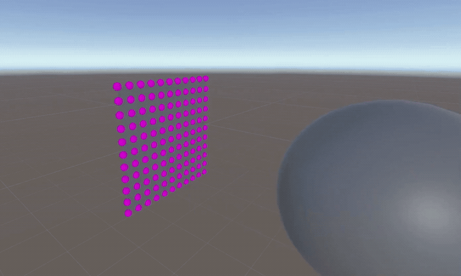
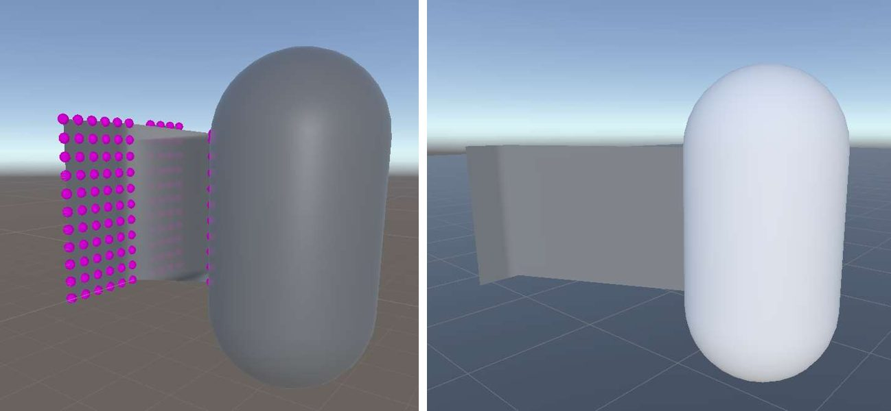
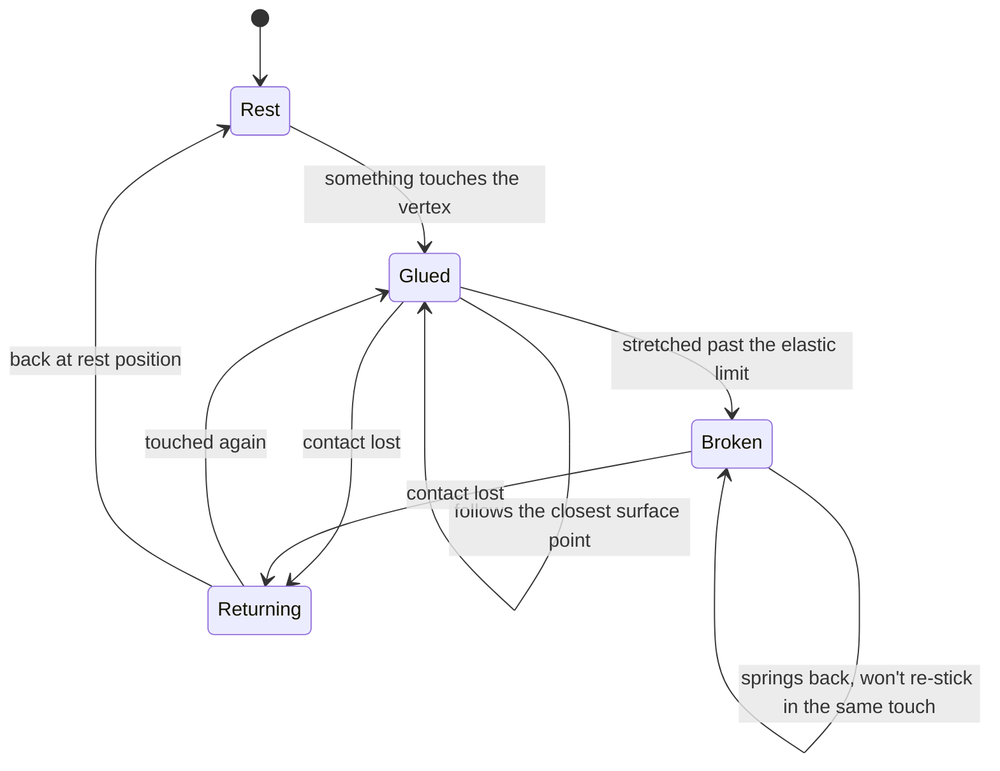
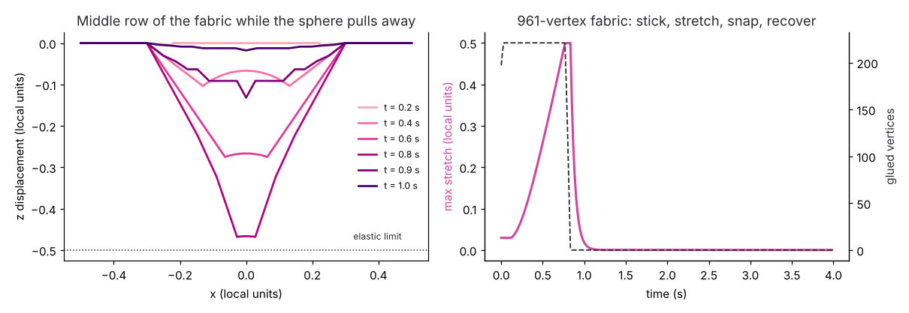

# Sticky Fabric — chewing-gum mesh deformation in Unity

[](https://github.com/miguelrg14/U_TFG_Sticky-Fabric-Unity/actions/workflows/ci.yml)


A procedural mesh that behaves like chewing gum: its vertices stick to whatever touches them, stretch as the object moves away, and snap back once they pass their elastic limit. It does this **without softbody springs, joints or shaders**: each vertex is handled on its own and tied to its original local position.

This is my Bachelor's thesis (*Trabajo de Fin de Grado*) for the Video Game Design and Development degree at UDIT, 2024–2025: **"Dynamic stretch fabrics with adhesion properties"**.



*From the thesis presentation: each magenta point is a vertex of the fabric. They stick to the sphere as it passes through, stretch with it and return to their place once they reach the elastic limit.*



> **Play it in the browser:** https://miguelrg14.github.io/U_TFG_Sticky-Fabric-Unity/ *(published by CI once the Unity license secrets are configured, see [CI](#continuous-integration))*

## Contents

| Part | Path | What it is |
|---|---|---|
| Solver (pure C#) | [`Sticky-Fabric/Assets/StickyFabric/Runtime/Core`](Sticky-Fabric/Assets/StickyFabric/Runtime/Core) | Grid generation and the per-vertex stick / stretch / release logic. No Unity dependency (`noEngineReferences`). |
| Unity component | [`Sticky-Fabric/Assets/StickyFabric/Runtime`](Sticky-Fabric/Assets/StickyFabric/Runtime) | `StickyFabricMesh`: builds the mesh, queries physics, uploads vertices. |
| Demo | [`Sticky-Fabric/Assets/StickyFabric/Demo`](Sticky-Fabric/Assets/StickyFabric/Demo) | Demo scene with a sphere moving through the fabric, plus an on-screen panel to tune it live. |
| Unity tests | [`Sticky-Fabric/Assets/StickyFabric/Tests`](Sticky-Fabric/Assets/StickyFabric/Tests) | EditMode (solver and component) and PlayMode (physics and demo scene) tests. |
| .NET tests | [`tests/StickyFabric.Core.Tests`](tests/StickyFabric.Core.Tests) | Runs the same solver tests with `dotnet test`, no Unity needed. |
| Simulation | [`tools/StickyFabric.Simulation`](tools/StickyFabric.Simulation) | Headless run of the solver used as a CI smoke test and for the charts below. |
| Thesis | [`docs/thesis/thesis-es.pdf`](docs/thesis/thesis-es.pdf) | Full thesis document (Spanish). |

## How it works

The fabric is a square grid created at start-up (`subdivisions` quads per side, so 10 subdivisions = 121 vertices). Every frame, each vertex goes through a small state machine:



1. **Contact detection.** A small sphere query (`contactRadius`) sits on every vertex. If a collider on `contactLayers` overlaps it, the vertex takes that collider's closest surface point.
2. **Adhesion.** If that point is within `elasticLimit` of the vertex's *original* local position, the vertex is moved onto it, so it sticks to the object and is dragged along.
3. **Release.** Once the object pulls the vertex past the limit, the bond breaks. A broken vertex doesn't stick again until it has lost contact, which prevents flickering.
4. **Elastic return.** A released vertex goes back to rest following the thesis formula
   `force = k·(distance − b)·direction − b·k·(v − v_prev)`. With `b = 0`, which is what the project uses, this is first-order relaxation, `dx/dt = −k·(x − rest)`. The solver integrates it exactly (`offset *= e^(−k·dt)`), so the motion is the same at 30 FPS or 300 FPS.

The chart below comes from the headless simulation. A sphere sits in a 961-vertex fabric and pulls away at 1 unit/s. The fabric stretches up to the 0.5 limit, snaps, and is back at rest about 0.3 s later.



## Running it

**Requirements:** Unity **6000.6.8f1** (Unity 6) with the Universal Render Pipeline. The thesis was originally developed with 2022.3.11f1.

1. Clone the repository and open the `Sticky-Fabric` folder from Unity Hub.
2. Open `Assets/StickyFabric/Demo/Scenes/StickyFabricDemo.unity` and press Play.

| Control | Action |
|---|---|
| Sliders | Subdivisions, elastic limit, return stiffness and contact radius, live |
| `Space` | Toggle between the automatic sphere movement and manual control |
| `WASD` / arrows | Move the sphere (manual mode) |
| `Q` / `E` | Move the sphere along the Z axis, through the fabric (manual mode) |
| `R` | Reset the sphere and the fabric |
| `H` | Hide or show the panel |

To use the effect in your own scene, add **Sticky Fabric Mesh** to an empty GameObject (it adds the `MeshFilter` and `MeshRenderer` it needs). Give it a material and set `Contact Layers` to the layers it should stick to. Keep the fabric itself on a different layer.

## Tests

The solver tests are written once in NUnit and run in two places: in Unity's Test Runner and with the .NET SDK.

```bash
# Solver tests, no Unity required (.NET 8 SDK)
dotnet test tests/StickyFabric.Core.Tests

# Headless simulation: exits with 1 if the fabric doesn't stick, overstretches or fails to recover
dotnet run --project tools/StickyFabric.Simulation

# Regenerate the chart above (Python 3 + matplotlib)
dotnet run --project tools/StickyFabric.Simulation -- --csv build/simulation
python tools/plot_simulation.py build/simulation docs/images/simulation.png
```

In Unity, open **Window → General → Test Runner**:

- **EditMode**: grid topology, the stick / break / return rules, frame-rate independence, argument validation, and the `StickyFabricMesh` component (mesh creation, rebuild, `MeshCollider` hookup).
- **PlayMode**: a real `SphereCollider` pulling away from the fabric. It checks that vertices stick, are never stretched past the limit, and that the rendered mesh ends exactly at rest. A second test loads the demo scene and checks that the moving sphere sticks to the fabric.

## Continuous integration

[`ci.yml`](.github/workflows/ci.yml) runs on every push and pull request:

| Job | Runs | Needs |
|---|---|---|
| Core tests and simulation | `dotnet test` and the headless simulation | nothing |
| Unity tests | EditMode and PlayMode tests with [GameCI](https://game.ci) | Unity license secrets |
| WebGL build and Pages deploy | builds the demo and publishes it to GitHub Pages (`main` only) | Unity license secrets |

[`release.yml`](.github/workflows/release.yml) runs when a `v*` tag is pushed. It builds Windows, Linux and WebGL players and attaches them to a GitHub release.

To enable the Unity jobs, add the repository secrets `UNITY_LICENSE` (the contents of your `.ulf` file), `UNITY_EMAIL` and `UNITY_PASSWORD` as described in the [GameCI activation guide](https://game.ci/docs/github/activation). Then set **Settings → Pages → Source** to **GitHub Actions**. Without those secrets, the Unity jobs are skipped and CI stays green on the .NET checks.

## Design notes

- **Engine-independent core.** All the deformation logic lives in `StickyFabric.Core`, which has no reference to `UnityEngine`. It uses `System.Numerics`, takes contacts through an `IContactQuery` interface and is fully unit-testable. The Unity component is a thin adapter around it.
- **One mesh upload per frame.** The original prototype re-uploaded the mesh and recalculated normals once per vertex, which is O(n²) per frame. The component now updates the mesh once per frame, and only when a vertex actually moved.
- **No per-frame allocations.** Physics queries use `OverlapSphereNonAlloc` with a reusable buffer, and the debug tools reuse their lists.
- **Correct spaces.** Vertex queries use `Transform.TransformPoint`, so the fabric can be moved, rotated and scaled.
- **Clear elastic limit.** The limit is measured from each vertex's rest position. A vertex that goes past it is released and won't re-stick during the same touch.
- **Known limitations.** `Collider.ClosestPoint` only works with primitive and convex colliders, so the fabric doesn't stick to concave `MeshCollider`s. Vertices are independent (no neighbour constraints), so very fast objects can tear individual vertices off. The thesis already pointed out the problems at high speeds.

## Thesis results

From the thesis, measured with the Unity Profiler on an Intel Core i7-10750H laptop with a GTX 1060, using the original prototype code:

- **121 vertices** (10 subdivisions), a capsule moving at constant speed 5 and elastic limit 2: vertices stick, stretch and return correctly. Frame rate, rendering and memory stay stable, and physics shows the most variation.
- **961 vertices** (30 subdivisions): still runs, but performance drops considerably (below 250 FPS).

The per-vertex mesh upload removed in this version (see design notes) grows quadratically with the vertex count, so it was likely a large part of that cost.

## Repository layout

```
Sticky-Fabric/                 Unity project (open this folder in Unity Hub)
  Assets/StickyFabric/
    Runtime/Core/              Pure C# solver (FabricGrid, FabricSolver, IContactQuery)
    Runtime/                   StickyFabricMesh component and physics adapter
    Demo/                      Demo scene, materials and helper scripts
    Tests/EditMode|PlayMode/   Unity Test Framework tests
  Assets/Settings/             URP pipeline assets
tests/StickyFabric.Core.Tests/ dotnet test project (links the Unity sources)
tools/                         Headless simulation and chart script
docs/                          Thesis PDF and README images
```

## References

- Danevičius, E., Maskeliūnas, R., Damaševičius, R., Połap, D., & Woźniak, M. (2018). *A soft body physics simulator with computational offloading to the cloud*. Information, 9(12), 318. https://doi.org/10.3390/info9120318
- Attard, P., & Parker, J. L. (1994). *Deformation and adhesion of elastic bodies in contact*. Physical Review E, 50(6), 5145. https://doi.org/10.1103/PhysRevE.50.5145

## License

[MIT](LICENSE) © Miguel Rodríguez Gallego
